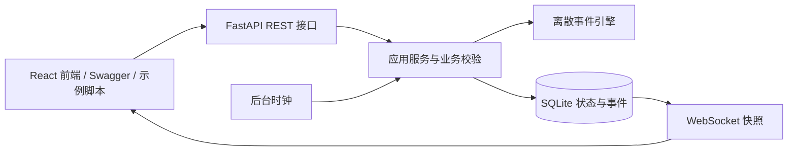

# 项目架构、目录结构和数据组织方案

## 分层



开发环境下前端的 `/api` 与 `/ws` 由 Vite 代理转发到后端，因此浏览器看到的是同源地址；代理只是转发，不改变接口语义。

总览及 `/devices` 通过 `DeviceTypeIndex` 提供类型入口；`/devices/:kind` 的 `DeviceOverview` 只显示路由指定的类型，使用 `/dashboard` 返回的设备及利用率，结合仿真快照中的批次显示当前工序、进度与等待原因。页面导航和设备选择不修改资源分配或统计口径。

`api.py` 负责协议、参数、鉴权、分页、生命周期；`service.py` 负责审核与状态变更；`engine.py` 负责资源分配及时间推进；`workflow.py` 负责工序生成与演示水量；`store.py` 负责数据库事务。引擎只修改传入状态并发出事件，可离开 HTTP 独立验证。

## 目录

```text
├── AGENTS.md
├── README.md
├── DESIGN.md
├── CHANGELOG.md
├── TODO.md
├── docs/
│   ├── PROJECT-SPEC.md
│   ├── ARCHITECTURE.md
│   ├── COMPONENT-GUIDELINES.md
│   ├── PAGE-STRUCTURE.md
│   ├── DEVELOPMENT.md
│   ├── REGISTRY.md
│   └── DEPLOYMENT.md
├── backend/                     # 后端全部代码、测试与启动入口
│   ├── app/
│   │   ├── __init__.py
│   │   ├── main.py                 # Uvicorn 入口
│   │   ├── api.py                  # REST 与 WebSocket
│   │   ├── models.py               # 请求模型与枚举
│   │   ├── service.py              # 业务与操作事务
│   │   ├── engine.py               # 离散事件调度
│   │   ├── workflow.py             # 工序、工位、水量假设
│   │   └── store.py                # SQLite 快照与事件
│   ├── tests/test_api.py
│   ├── scripts/demo.py
│   ├── examples/prescription.json
│   ├── data/                       # 自动创建数据库；不提交
│   ├── requirements.txt
│   ├── requirements-lock.txt        # 已验证环境的依赖锁定清单
│   ├── .env.example
│   ├── .gitignore
│   ├── start.ps1
│   └── 启动后端.cmd
└── frontend/                    # React 18 + AntD 5 + Vite 前端
    ├── index.html
    ├── package.json
    ├── vite.config.js              # 开发服务器 5173，/api 与 /ws 代理到 8000
    ├── public/favicon.svg
    └── src/
        ├── main.jsx                # React 入口与 AntD 主题
        ├── App.jsx                 # 路由
        ├── api/client.js           # REST 封装与错误结构
        ├── hooks/useSimulation.js  # WebSocket 快照订阅与重连
        ├── domain/labels.js        # 后端枚举的中文映射与格式化
        ├── components/             # AppShell、Display、TraceChart
        ├── pages/                  # Overview、Simulation、BatchList、BatchDetail
        └── styles/                 # tokens.css 设计变量、app.css 布局
```

## 数据组织

SQLite 包含两张表。`simulation_state` 的单条 JSON 快照保存时钟、处方、批次、设备和报警；`events` 是独立追加的事件表，包含全局递增 ID、累计运行秒数（沿用 `sim_time` 字段）、真实 UTC 记录时间、类型、实体 ID 和载荷。`entity_id,id` 索引支持追溯。状态与事件在同一 `BEGIN IMMEDIATE` 事务中提交，异常则同时回滚。

该聚合快照方案适用于本地、小规模演示，每次变更需要读写完整状态。批次和处方很多时应拆分为规范化表、归档历史，并让调度器单独运行。事件不写入快照，避免每次复制全部历史。

| 实体 | 关键关联 |
|---|---|
| Prescription | `external_no` 在业务层唯一，`batch_id` 一对一关联 |
| Batch | `prescription_id`、`trace_code`、`steps`、`pot_id` |
| Device | `kind`、`status`、`batch_id`、占用与有效工作时长 |
| Alarm | `device_id`、故障发生时 `batch_id`、确认与解决状态 |
| Event | `entity_id` 对应处方、批次、设备、报警或全局仿真 |

## 状态与时间

处方：`pending_review → approved / rejected`。批次：`queued → running ↔ paused → completed`；取消后有锅则先清洗，最终 `cancelled`。`cancel_requested` 表示取消处理中，`dispatched` 表示成品已配发。锅具故障或当前工位故障通过等待原因显示，批次保留运行状态并停止进度。

设备：`idle / busy / fault / offline`。发生故障仍保留所属批次，维修恢复为 `busy` 或 `idle`；只允许空闲设备停用。暂停批次保留全部已分配资源。

引擎推进到最近的工序完成点或后下投料点，处理释放和重新派工，再推进剩余时间。因此大步长不会跳过中间工序。资源按批次优先级排序，同优先级按创建序号排序；进行中的工序不被抢占。锅容量按演示总加水量保守筛选。

正常运行固定真实时间 1 倍速：服务层使用单调时钟，每约 250ms 按实际经过秒数推进一次，不读取历史倍速字段作为乘数；WebSocket 每约 500ms 提供新快照或心跳。前端另外显示当前北京时间。重启后时钟暂停且倍率归一，不补算停机时间。引擎仍只接收经过秒数，不读取系统时间。离线调试步进默认关闭，仅显式启用 `DECOCTION_ALLOW_DEBUG_STEP=1` 且全局暂停时允许。

工序新默认用时见 `PROJECT-SPEC.md`，由 `workflow.py` 定义固定工位时长、`models.py` 定义可调工艺默认值；包装每批固定 300 秒。默认额外升温为 0，跳过独立升温节点，避免给 15 分钟煎煮再加时间。已有批次的工序快照不回写。

## 测量与统计边界

温度在工序起始温度与目标温度间线性插值，排队与暂停期间不变化。表压固定为零。水量是演示估算，不模拟实际剩余水量和药效。`produced_bags` 在包装结束时一次性计数，`dispatched_bags` 在配发后统计。

`productive_seconds` 是有效工序推进时间；`occupied_seconds` 包括单批次暂停、排队和故障，均不计入全局暂停。利用率为有效时长除以设备加入后累计运行时间；吞吐量为已配发袋数除以累计运行时间，兼容旧字段名 `bags_per_virtual_hour`，均不是实际工厂性能承诺。历史记录可能来自旧版加速时钟。

## 运行边界

进程内使用可重入锁，SQLite 事务串行化写入。只能启动一个服务进程使用同一数据库：多 worker 会各自运行时钟和执行重启暂停。数据库不宜放在网络共享目录。当前没有账户隔离、历史删除接口或在线重置接口。
