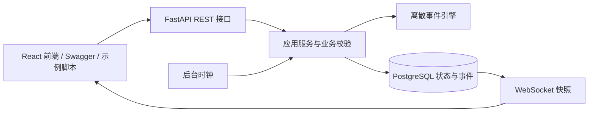

# 项目架构、目录结构和数据组织方案

## 分层



开发环境下前端的 `/api` 与 `/ws` 由 Vite 代理转发到后端，因此浏览器看到的是同源地址；代理只是转发，不改变接口语义。

根目录 `compose.yaml` 编排三个服务。`frontend` 用 Nginx 提供静态页面、SPA 路由回退，并转发 REST、WebSocket 和健康检查到 `backend:8000`。`backend` 以非 root 用户启动单个 Uvicorn worker。`db` 在内网运行 PostgreSQL 17，将数据写入 `postgres-data` 命名卷。Nginx 是唯一发布到宿主机的服务，Compose 按数据库、后端、前端的健康检查顺序启动。

总览、设备页、仿真工作台和批次页共用仿真快照。总览从 `summary` 读取指标，设备页从 `devices` 读取利用率，结合 `batches` 显示批次状态。`/dashboard` 继续提供同一口径的 REST 查询，旧版后端缺少快照汇总时总览和设备页每次查询完成后间隔 3 秒再查。批次详情通过事件游标补充温度采样。

`api.py` 负责统一鉴权、生命周期及路由组装，`prescription_routes.py` 负责处方协议与参数，`pagination.py` 维护共用分页响应；`service.py` 负责审核与状态变更；`engine.py` 负责资源分配及时间推进；`workflow.py` 负责工序生成与演示水量；`store.py` 负责数据库事务。引擎只修改传入状态并发出事件，可离开 HTTP 独立验证。

## 计数与重量

`Herb.unit` 默认 `g`，兼容原 `grams_per_dose` 请求；`piece` 使用 `quantity_per_dose` 保存每剂片数。审核 `herb_grams_per_dose` 仅补计数饮片的实际重量，修改、状态及事件仍在同一事务内提交。批次创建另行验证重量完整，再调用现有 `water_plan`；计数不参与质量加总。现有 JSON 持久化保留新增字段，无需回写历史数据。

## 目录

```text
├── AGENTS.md
├── README.md
├── DESIGN.md
├── CHANGELOG.md
├── TODO.md
├── compose.yaml                 # 前端、后端和 PostgreSQL 服务
├── .env.example                 # Compose 部署配置模板
├── docs/
│   ├── PROJECT-SPEC.md
│   ├── ARCHITECTURE.md
│   ├── COMPONENT-GUIDELINES.md
│   ├── PAGE-STRUCTURE.md
│   ├── DEVELOPMENT.md
│   ├── REGISTRY.md
│   └── DEPLOYMENT.md
├── backend/                     # 后端全部代码、测试与启动入口
│   ├── app/
│   │   ├── __init__.py
│   │   ├── main.py                 # Uvicorn 入口
│   │   ├── api.py                  # REST 与 WebSocket 组装
│   │   ├── prescription_routes.py # 处方录入、查询和人工审核
│   │   ├── pagination.py          # 共用列表分页响应
│   │   ├── models.py               # 请求模型与枚举
│   │   ├── service.py              # 业务与操作事务
│   │   ├── engine.py               # 离散事件调度
│   │   ├── workflow.py             # 工序、工位、水量假设
│   │   ├── store.py                # PostgreSQL 快照、事件及离线导入
│   │   └── migrate_sqlite.py       # 旧 SQLite 一次性导入入口
│   ├── tests/test_api.py
│   ├── scripts/demo.py
│   ├── examples/prescription.json
│   ├── data/                       # 可能存在旧 SQLite 源文件，不提交
│   ├── requirements.txt
│   ├── requirements-lock.txt        # 已验证环境的依赖锁定清单
│   ├── Dockerfile                   # 非 root、单 worker 的 Python 容器
│   ├── .dockerignore
│   ├── .env.example
│   ├── .gitignore
│   ├── start.ps1
│   └── 启动后端.cmd
└── frontend/                    # React 18 + AntD 5 + Vite 前端
    ├── Dockerfile                  # Node 构建 / Nginx 静态服务
    ├── .dockerignore
    ├── nginx.conf                  # 生产代理与页面路由回退
    ├── index.html
    ├── package.json
    ├── vite.config.js              # 开发服务器 5173，/api 与 /ws 代理到 8000
    ├── public/favicon.svg
    └── src/
        ├── main.jsx                # React 入口与 AntD 主题
        ├── App.jsx                 # 路由
        ├── api/client.js           # REST 封装与错误结构
        ├── hooks/useSimulation.js  # WebSocket 快照订阅与重连
        ├── domain/labels.js        # 后端枚举的中文映射与格式化
        ├── components/             # AppShell、Display、TraceChart
        ├── pages/                  # Overview、Simulation、BatchList、BatchDetail
        └── styles/                 # tokens.css 设计变量、app.css 布局
```

## 数据组织

PostgreSQL 包含两张表。`simulation_state` 的单条快照保存时钟、处方、批次、设备和报警，使用 `json` 保留既有记录顺序。`events` 使用自增 `BIGINT` 事件编号，保存累计运行秒数 `sim_time`、UTC 时间、类型、实体 ID 和载荷。`entity_id,id` 索引支持追溯。写入通过 `SELECT ... FOR UPDATE` 锁定状态行，将进度、资源分配和事件放在同一事务提交。读取快照和最新事件编号使用同一条 SQL，保证观察到同一次提交。

一次性 SQLite 导入保留快照、事件编号和 SQLite 事件序列的高水位。导入应在源服务停止后执行，失败时整笔回滚。迁移命令见 `DEPLOYMENT.md`。

该聚合快照方案适用于本地、小规模演示，每次变更需要读写完整状态。批次和处方很多时应拆分为规范化表、归档历史，并让调度器单独运行。事件不写入快照，避免每次复制全部历史。

| 实体 | 关键关联 |
|---|---|
| Prescription | `external_no` 在业务层唯一，`batch_id` 一对一关联 |
| Batch | `prescription_id`、`trace_code`、`steps`、`pot_id` |
| Device | `kind`、`status`、`batch_id`、占用与有效工作时长 |
| Alarm | `device_id`、故障发生时 `batch_id`、确认与解决状态 |
| Event | `entity_id` 对应处方、批次、设备、报警或全局仿真 |

## 状态与时间

处方：`pending_review → approved / rejected`。批次：`queued → running ↔ paused → completed`；取消后有锅则先清洗，最终 `cancelled`。`cancel_requested` 表示取消处理中，`dispatched` 表示成品已配发。锅具故障或当前工位故障通过等待原因显示，批次保留运行状态并停止进度。

设备：`idle / busy / fault / offline`。发生故障仍保留所属批次，维修恢复为 `busy` 或 `idle`；只允许空闲设备停用。暂停批次保留全部已分配资源。

引擎推进到最近的工序完成点或后下投料点，处理释放和重新派工，再推进剩余时间。因此大步长不会跳过中间工序。资源按批次优先级排序，同优先级按创建序号排序；进行中的工序不被抢占。锅容量按演示总加水量保守筛选。

正常运行固定真实时间 1 倍速。服务层使用单调时钟，每约 250ms 按实际经过秒数推进一次，修改状态前在同一事务中按旧状态结算时间。全局暂停时，人工操作可改变设备或批次状态，新派工在继续运行或调试推进时发生。WebSocket 每约 1 秒提供新快照或心跳，同一提交版本复用快照。前端另外显示当前北京时间。重启后时钟暂停且倍率归一。引擎只接收经过秒数。离线调试步进默认关闭，仅显式启用 `DECOCTION_ALLOW_DEBUG_STEP=1` 且全局暂停时允许。

工序新默认用时见 `PROJECT-SPEC.md`，由 `workflow.py` 定义固定工位时长、`models.py` 定义可调工艺默认值；包装每批固定 300 秒。默认额外升温为 0，跳过独立升温节点，避免给 15 分钟煎煮再加时间。已有批次的工序快照不回写。

## 测量与统计边界

温度在工序起始温度与目标温度间线性插值，排队与暂停期间不变化。工序开始和结束各记录采样，工序运行中的额外采样间隔至少为 5 个仿真秒。表压固定为零。水量采用演示估算。`produced_bags` 在包装结束时一次性计数，`dispatched_bags` 在配发后统计。

`productive_seconds` 是有效工序推进时间；`occupied_seconds` 包括单批次暂停、排队和故障，均不计入全局暂停。利用率为有效时长除以设备加入后累计运行时间；吞吐量为已配发袋数除以累计运行时间，兼容旧字段名 `bags_per_virtual_hour`，均不是实际工厂性能承诺。历史记录可能来自旧版加速时钟。

## 运行边界

进程内可重入锁保护单调时钟和快照缓存，PostgreSQL 行锁保护数据库写入。同一数据库仅运行一个服务进程，多个 worker 会各自驱动时钟并执行重启暂停。当前没有账户隔离、历史删除接口或在线重置接口。

## 本草处方对接

本草将已确认药材转换为平台请求，平台复用处方业务及 PostgreSQL 事务。外部编号在录入事务内唯一，新记录进入待人工审核状态。完整接收约定见 [本草对接说明](BENCAO-INTEGRATION.md)。
